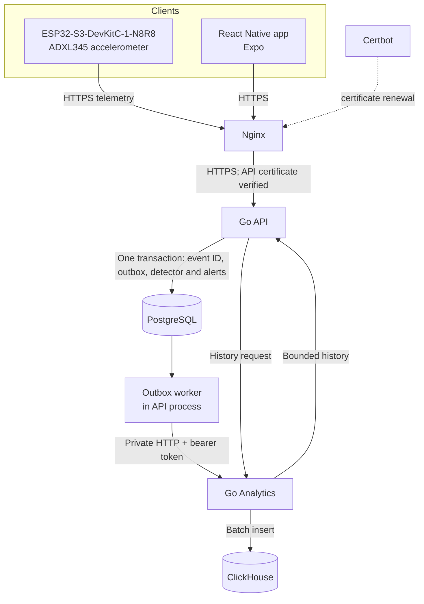
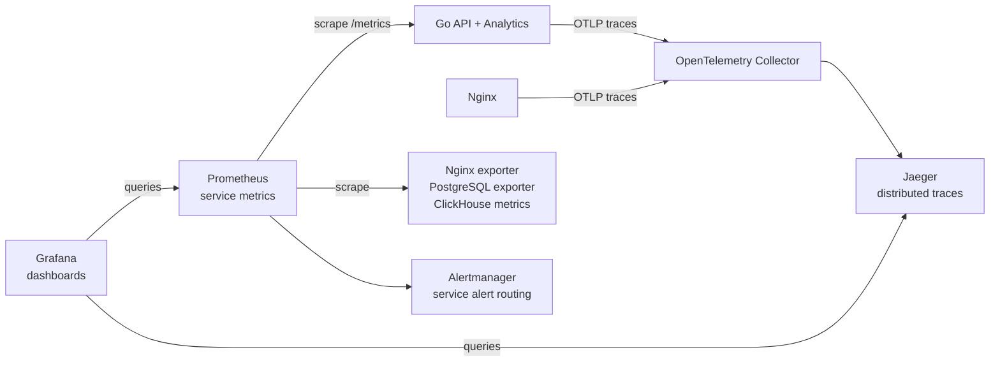

# Machine Whisperer — project architecture decisions

**Status:** MVP decisions and target architecture

**Last reviewed:** 2026-11-24

This document records the intended end state of the project: product, services,
data flow, detection, hardware and deployment decisions.

## 1. Context and product boundary

Machine Whisperer helps an operator notice sustained vibration changes on
steady-running equipment such as fans and pumps. A **machine** is the physical
equipment being monitored. A **device** is a separate sensor node attached to a
machine. The device has its own identity and sends readings for the machine to
which it was enrolled. A user account owns one or more machines and can review
their histories and alerts in the mobile app.

The system reports deviations from a machine-specific reference. It does not
diagnose a component or predict a failure date. It is designed first for
equipment that runs at a steady speed and load. Machines with multiple
operating modes need separate mode detection and baselines and are outside the
MVP.

## 2. Architecture decision

Use a Go API as the public entry point and operational system of record. Store
account, access, machine, device, baseline and alert state in PostgreSQL. Keep
the full telemetry history in ClickHouse, owned by a separate Go Analytics
service. Deliver telemetry from the API to Analytics through an outbox worker
inside the API process. Serve the owner-facing experience through a React Native
app built with Expo. Place Nginx at the public edge and manage public TLS with
Certbot. A separate observability stack handles service metrics, traces,
dashboards and alert routing.



The API and Analytics service have separate databases and responsibilities. The
mobile app and sensor device never connect directly to either database. The
outbox worker stays in the API service; a second API entry point or a service
sharing the API database is unnecessary.

| Component | Decision |
| --- | --- |
| Public API and outbox worker | Go, chi, PostgreSQL; worker runs in the API process |
| Analytics and history | Separate Go HTTP service backed by ClickHouse |
| Mobile client | React Native with Expo |
| Edge and public certificates | Nginx with Certbot and HTTP-01 validation |
| Service deployment | Docker Compose on a Linux host; start with one host and scale when measured load requires it |
| Observability in MVP | OpenTelemetry SDKs and Collector, Prometheus and Alertmanager for service alerting, Jaeger for traces, Grafana for dashboards |

### Service observability



Prometheus scrapes private metrics endpoints for the API, Analytics, Nginx,
PostgreSQL and ClickHouse. It evaluates service alert rules and sends firing
alerts to Alertmanager for grouping and notification. Jaeger stores and displays distributed
traces. Grafana queries Prometheus and Jaeger. Machine vibration alerts are
created by the API and shown in the mobile app; they are separate from
service-health alerts.

## 3. Device and hardware decision

The development hardware is the **Espressif ESP32-S3-DevKitC-1-N8R8** board and
an **ADXL345 accelerometer breakout**. The board uses the ESP32-S3-WROOM-1-N8R8
module, exposes its GPIO pins for wiring and provides 8 MB flash and 8 MB PSRAM.
Use the 3.3 V variant. The production device will use a compact board with the
same MCU family and sensor; the development kit is for firmware bring-up.
Mount the sensor rigidly on the machine; vibration testing requires soldered or
locking connections, not a loose breadboard assembly.

The ADXL345 measures acceleration independently along X, Y and Z. It senses
both gravity and dynamic movement or shock; it does not measure velocity,
displacement, current, sound or a fault type. Its ranges are ±2, ±4, ±8 or ±16 g.
In full-resolution mode it provides up to 13-bit output with a nominal scale of
3.9 mg/LSB. It outputs signed digital samples over I²C or SPI and contains a
32-sample FIFO. The chosen initial configuration is full-resolution ±16 g at
800 samples per second (ODR), giving a 400 Hz bandwidth. This suits an initial
low-frequency RMS trend detector; it does not cover higher-frequency bearing
analysis. Sensor noise and mounting must be checked against the expected
vibration amplitude.

### Wiring and firmware sampling

Use the Adafruit ADXL345 breakout, product 1231, with its I²C interface. Connect
ESP32 3V3 to `VIN`, ground to `GND`, GPIO 8 to `SCL`, GPIO 9 to `SDA`, and the
breakout `INT1` output to GPIO 4 for the FIFO watermark interrupt. The breakout
uses I²C address `0x53` by default and includes the required I²C pull-ups. Set
the ADXL345 FIFO to stream mode with a 16-sample watermark. At 800 Hz this
interrupts the ESP32 every 20 ms; firmware reads the available XYZ samples in a
single burst over 400 kHz I²C. The ADXL345 datasheet limits the recommended ODR
to 800 Hz at that I²C rate.

For each 60-second observation window, firmware converts the signed sensor
counts to g and accumulates the 48,000 XYZ samples. It does not retain the raw
window. At the window end it removes each axis mean and calculates the combined
RMS vibration:

```text
mean_x = sum(x_i) / N
mean_y = sum(y_i) / N
mean_z = sum(z_i) / N
vibration_rms_g = sqrt(sum((x_i-mean_x)^2 + (y_i-mean_y)^2 + (z_i-mean_z)^2) / N)
```

The device synchronizes its clock and timestamps the end of the window in UTC.
It sends one JSON event each minute to `POST /v1/devices/me/telemetry` over
HTTPS. The device authenticates with its own API key. The API resolves
the device's claimed machine from that identity, so the firmware does not need
to receive or store a machine ID. The payload is:

```http
POST /v1/devices/me/telemetry
Authorization: Bearer <device_id.secret>
Content-Type: application/json
```

```json
{
  "schema_version": 1,
  "event_id": "a5b96d2a-5cb0-4f3b-9d64-f3f53de41071",
  "observed_at": "2026-11-24T12:01:00Z",
  "operating_state": "running",
  "vibration_rms_g": 0.043,
  "dominant_frequency_hz": null,
  "current_rms_a": null
}
```

This firmware reports RMS only; the ADXL345 does not provide current or
dominant-frequency measurements. The API responds `202` with an empty body once
the event is durably queued. On retry, the device resends the same event ID and
body. Set `operating_state` to `running` only when a trusted machine schedule or
signal says the machine is running; otherwise send `unknown`. The ADXL345's
activity/inactivity interrupt reports whether acceleration crossed a configured
motion threshold. It does not establish that the machine is running normally or
is healthy, so it cannot by itself set `operating_state`.

References: [Analog Devices ADXL345 datasheet](https://www.analog.com/media/en/technical-documentation/data-sheets/adxl345.pdf),
[Espressif ESP32-S3-DevKitC-1 guide](https://docs.espressif.com/projects/esp-idf/en/v5.1/esp32s3/hw-reference/esp32s3/user-guide-devkitc-1-v1.0.html),
[Adafruit ADXL345 breakout wiring](https://learn.adafruit.com/adxl345-digital-accelerometer/assembly-and-wiring).

## 4. Identity, enrollment and ownership

User authentication uses short-lived signed access JWTs and rotating refresh
tokens. PostgreSQL stores user role assignments. Access-token claims include
standard identity/session fields, issuer `machine-whisperer`, audience
`machine-whisperer-api` and the assigned roles. Authentication middleware
validates the token; authorization middleware checks the required role for a
route.

A provisioning operator with the `device_provisioner` role creates a device
identity and a one-time claim code. The device API key is programmed into that
unit during assembly. The operator prints a QR code containing the versioned
claim payload, not the device API key. At installation, the owner creates a
machine and scans the QR code to bind the device to it. The claim code is
single-use and expires. The device can submit telemetry only for its enrolled
machine.

Nginx restricts the provisioning route to the manufacturing network or station
gateway. The signed role check and the network boundary both apply. Users can
access only the machines they own. Device credentials grant no app access.

PostgreSQL stores each new device's authenticated provisioning account in
`devices.provisioned_by_user_id`, using the signed JWT subject. This nullable
foreign key uses `ON DELETE SET NULL` to preserve devices when a factory
operator account is deleted. The attribution stays internal to the API.
Synthetic demo rollback locks its dedicated account, deletes its attributed
unclaimed devices, and deletes the account in one PostgreSQL transaction.
Claimed demo devices are removed with the demo machines.

## 5. Baselines, telemetry and alerts

For each supported machine, the project supplies a baseline based on reference
measurements from that machine in a known healthy, steady-running condition. It
contains RMS mean (`mean_rms_g`) and standard deviation (`stddev_rms_g`) in g.
The owner reviews and accepts the values for their machine; they are not expected
to estimate these statistics. A baseline is versioned and associated with its
machine; the source readings and validation method are recorded with its
configuration. The standard deviation describes the usual spread of healthy RMS
readings around the machine's mean; a z-score expresses a new reading's distance
from that mean in units of this spread.

For every newly accepted `running` observation with a baseline, the API computes
`abs(vibration_rms_g - mean_rms_g) / stddev_rms_g`. By default, three
consecutive scores of at least 3 open an alert; three consecutive scores of at
most 2 recover it. The alert preserves the trigger reading and baseline
snapshot, last and peak z-scores, and recovery reading. An `unknown` observation
resets pending counts without changing an active alert. Exact event retries do
not advance detector state. A device going offline is not evidence that a
machine is healthy or faulty.

The baseline is configured per machine; it is not learned from each incoming
batch. In a later analytics phase, ClickHouse history can be analyzed to propose
baseline adjustments using verified healthy observations. Changes must be
reviewed and versioned. This rule is a transparent deviation detector, not a
validated fault diagnosis algorithm. Accuracy and false-alert rates require
evaluation against representative healthy and labelled-fault data from the
target machines.

## 6. Data ownership and delivery

On telemetry ingestion, one PostgreSQL transaction records the event ID and
payload hash for deduplication, stores the outbox payload, advances detector
state and writes alert changes. The event identity is retained for a bounded
retry window; it is not the long-term telemetry history. The outbox is a
delivery queue: it keeps accepted readings until Analytics confirms the batch.

The worker leases pending outbox rows and posts batches to the private Analytics
endpoint. Analytics writes them to ClickHouse and acknowledges only after a
successful insert. Delivery is at least once; ClickHouse queries deduplicate by
`(machine_id, observed_at, device_id, event_id)`. A successful device response
means PostgreSQL committed the event; the history view may update later.

PostgreSQL is authoritative for account, machine, device, baseline and alert
state. ClickHouse is authoritative for telemetry history and analysis. The two
services do not share database tables. The outbox retains undelivered events
until success and delivered rows for a limited cleanup period. Its retention
and device retry lifetime must be configured together.

## 7. API contracts and mobile experience

The REST API uses versioned JSON routes and UTC timestamps. User routes require
an Ed25519-signed access JWT with issuer `machine-whisperer`, audience
`machine-whisperer-api`, standard user/session claims and assigned roles.
Device routes use the device API key. The API verifies the caller and ownership
before returning machine data.

| Method and path | Caller | Request | Success |
| --- | --- | --- | --- |
| `POST /v1/auth/signup` | Public | `{"email":"owner@example.com","password":"…"}` | `201` with `id`, canonical `email`, `created_at`; does not create a session |
| `POST /v1/auth/login` | Public | Same email/password object | `200` with `access_token`, `token_type: "Bearer"`, `expires_in`, `refresh_token` |
| `POST /v1/auth/refresh` | Public | `{"refresh_token":"…"}` | `200` with replacement access and refresh tokens |
| `POST /v1/auth/logout` | Public | `{"refresh_token":"…"}` | `204`, empty body |
| `GET /v1/users/me` | User JWT | No body | `200` with `id`, `email`, `created_at` |
| `POST /internal/v1/device-provisioning` | User JWT with `device_provisioner`; manufacturing network | No body | `201` with `device_id`, one-time `api_key`, and `claim_payload` |
| `POST /v1/machines` | User JWT | `{"name":"Pump"}` | `201` with `id`, `name`, `created_at` |
| `GET /v1/machines` | User JWT | No body | `200` with the owner's active machines |
| `GET /v1/machines/{id}` | User JWT | No body | `200` with the active owned machine |
| `DELETE /v1/machines/{id}` | User JWT | No body | `204` after archiving an owned machine or on the owner's retry |
| `POST /v1/devices/claim` | User JWT | `device_id`, `claim_code`, `machine_id` | `200` with `device_id`, `machine_id`, `status: "claimed"` |
| `POST /v1/devices/me/telemetry` | Device API key | Telemetry event, shown in §3 | `202`, empty body; event is queued for export |
| `GET /v1/machines/{id}/baseline` | User JWT | No body | `200` with the prepared baseline for that machine |
| `GET /v1/machines/{id}/telemetry` | User JWT | Optional `limit` and opaque `cursor` | `200` with `items` and `next_cursor` |
| `GET /v1/machines/{id}/alerts` | User JWT | No body | `200` with alerts, newest trigger first |
| `POST /v1/alerts/{id}/acknowledge` | User JWT | No body | `204`, empty body |

Provisioning returns a QR payload such as
`{"v":1,"device_id":"…","claim_code":"…"}`. The user creates a machine
and claims the device by scanning that QR. Claiming creates the device-to-machine
association in PostgreSQL. Later, the device authenticates to
`/v1/devices/me/telemetry`; the API gets the device identity from its key and
resolves the claimed machine. The firmware never needs the machine ID.

Provisioning returns the one-time device key separately from the QR payload:

```json
{
  "device_id": "22222222-2222-4222-8222-222222222222",
  "api_key": "22222222-2222-4222-8222-222222222222.<secret>",
  "claim_payload": {
    "v": 1,
    "device_id": "22222222-2222-4222-8222-222222222222",
    "claim_code": "<one-time-code>"
  }
}
```

The owner creates a machine with `POST /v1/machines` and
`{"name":"Pump"}`. To claim the device, the app sends the QR values and
machine ID to `POST /v1/devices/claim`:

```json
{
  "device_id": "22222222-2222-4222-8222-222222222222",
  "claim_code": "<one-time-code>",
  "machine_id": "11111111-1111-4111-8111-111111111111"
}
```

Claim success returns `{"device_id":"…","machine_id":"…","status":"claimed"}`.

Each supported machine has a project-supplied baseline from its healthy reference
measurements. The owner can review it in the app; owners do not calculate or
submit mean and standard deviation. The owner-facing baseline response is:

```json
{
  "machine_id": "11111111-1111-4111-8111-111111111111",
  "mean_rms_g": 0.4,
  "stddev_rms_g": 0.05,
  "version": 1,
  "updated_at": "2026-11-24T12:00:00Z"
}
```

Baseline values are loaded through controlled machine setup and versioned when
changed. The exact operator workflow for loading and replacing those values is
an open decision. History is newest first; the default page size is 100 and the
maximum is 1,000. A history response contains an `items` array and an opaque
`next_cursor`, which is null on the final page. Alert records include the trigger
event and device, trigger time and z-score, baseline version and values, last and
peak z-scores, optional recovery data and the first acknowledgement time.

For example, a history page uses this response shape:

```json
{
  "items": [
    {
      "device_id": "22222222-2222-4222-8222-222222222222",
      "event_id": "a5b96d2a-5cb0-4f3b-9d64-f3f53de41071",
      "received_at": "2026-11-24T12:01:00.987654Z",
      "schema_version": 1,
      "observed_at": "2026-11-24T12:01:00Z",
      "operating_state": "running",
      "vibration_rms_g": 0.043,
      "dominant_frequency_hz": null,
      "current_rms_a": null
    }
  ],
  "next_cursor": null
}
```

An alert acknowledgement has no request body and returns `204`. It records the
first time the owner saw the alert; it does not close an active alert. A request
for a machine or alert outside the user's ownership returns `404`.

The mobile app supports account access, machine list and details, QR device
claim, review of the supplied machine baseline, telemetry history and alert
acknowledgement. It does not present a 0–100 health score, estimated avoided
costs or a maintenance journal. Push notifications and email alerts are outside
the MVP.

## 8. Deployment and operations

Package PostgreSQL, ClickHouse, API, Analytics, Nginx, Prometheus and Certbot in
a Docker Compose deployment on a Linux host. Nginx terminates public TLS and
verifies the API's internal HTTPS certificate using a project CA. API-to-
Analytics traffic uses a bearer token on the private Compose network. Certbot
uses HTTP-01 validation on port 80; public API and app traffic use port 443.
Renewal reloads Nginx after a successful certificate update.

Provisioning is limited by a configurable manufacturing-network CIDR at Nginx
and by the user's signed role in the API. PostgreSQL, ClickHouse and Prometheus
data use persistent volumes with documented backup and restore procedures.
Instrument the Go API and Analytics with OpenTelemetry SDKs and send OTLP traces
to an OpenTelemetry Collector that exports to Jaeger. Prometheus scrapes the Go
services and infrastructure metrics on private networks. It evaluates service
alert rules and sends firing alerts to Alertmanager for grouping and routing. Grafana dashboards
query Prometheus and Jaeger. This observability stack monitors services; machine
vibration alerts remain API records shown in the owner app. Nginx remains the
public edge and the API upstream proxy.

## 9. Alternatives considered

- **Write directly from the API to ClickHouse:** rejected because an Analytics
  outage would couple device acceptance to history storage. The transactional
  outbox allows the API to accept an event and retry delivery.
- **Store the only copy of telemetry in PostgreSQL:** rejected for the target
  architecture because ClickHouse is the dedicated store for long-term history
  and cross-machine analysis.
- **Train the baseline automatically during ingestion:** rejected for the MVP
  because an individual reading cannot establish that the machine is healthy.
  Baselines are supplied for specific machines; later analytics may propose
  reviewed adjustments from verified healthy history.

## 10. Open decisions

- Final sensor mount and validation dataset for the selected board and ADXL345.
- Device Wi-Fi credential setup during installation.
- Nginx metrics collection method and the final service metric/trace set.
- Controlled operator workflow to load and version machine-specific baselines.
- Source readings, calibration process and ownership for machine-specific
  baselines.
- Retention periods for event IDs, delivered outbox rows and ClickHouse history.
- Application metric set, service alert rules and receivers, availability and
  recovery objectives.
- Review and approval process for future Analytics baseline proposals.
