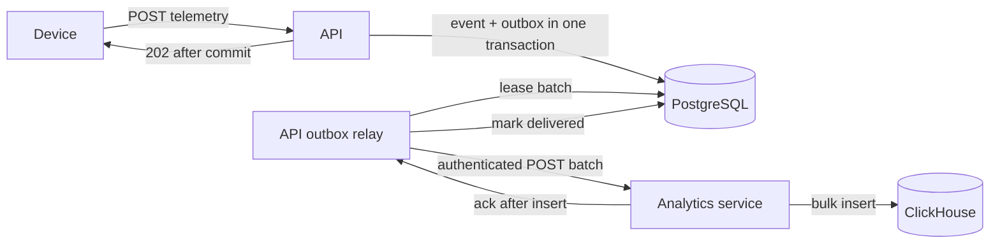

# ClickHouse Outbox Exporter

**Status:** Implemented for the exporter scope; baseline analysis remains future work.

**Date:** 2026-11-23

## Intent

Deliver accepted telemetry from the PostgreSQL outbox to ClickHouse in the
background. The API continues to acknowledge an event once PostgreSQL commits
it; an analytics worker retries delivery independently.

## Goals

- Add the separate Go analytics service described in the repository design.
- Claim pending telemetry outbox rows safely across multiple worker replicas.
- Batch inserts into ClickHouse and recover after worker, database or network
  failures without losing undelivered events.
- Make at-least-once retries logically deduplicable using the stable device and
  event IDs.
- Keep delivered outbox data for a bounded period and retain undelivered rows
  until successful delivery.
- Use structured logs without credentials, raw telemetry values or connection
  strings.

## Non-goals

- Device firmware or manufacturing provisioning.
- Detector updates, baseline learning, alerts or notifications.
- Historical telemetry API, charts or mobile screens.
- Exactly-once delivery across PostgreSQL and ClickHouse.

## Approaches

1. **Synchronous ClickHouse writes from the API handler.** This makes API
   success depend on ClickHouse availability and cannot atomically commit with
   PostgreSQL. Rejected.
2. **API-side outbox relay posts leased batches to the analytics service.**
   The API commits telemetry and outbox together, then a separate relay leases
   rows and sends batches over an authenticated internal endpoint. Analytics
   writes the batch to ClickHouse and acknowledges success. The API marks the
   rows delivered only after that acknowledgement. Recommended.
3. **Analytics reads the API PostgreSQL outbox directly.** This removes the
   internal HTTP hop, but gives analytics access to an API-owned table and
   couples both services to its schema. Rejected.

## Proposed behavior

### Data flow

The API does not connect to ClickHouse. It commits the accepted event and its
outbox row to PostgreSQL together, then returns `202`. A separate API relay
leases outbox batches and POSTs them to the analytics service. Analytics writes
the batch to ClickHouse and acknowledges only after a successful insert; the
relay then marks the rows delivered in PostgreSQL.

The API's `telemetry_events` row is only the 30-day idempotency ledger: it
stores device/event IDs, machine ID, observation time, payload hash and expiry.
The full v1 measurement payload is stored once, in `telemetry_outbox`. Keeping
these lifecycles separate lets expired idempotency records be cleaned up while
an undelivered export payload remains queued.

### Service boundary and configuration

Add an API-side relay worker to the API module and create an `analytics/` Go
module for the internal batch endpoint and ClickHouse writer. The API and relay
use the API-owned PostgreSQL outbox; analytics has no PostgreSQL connection and
does not read API tables. The relay sends batches to an authenticated internal
endpoint using a dedicated service credential. Analytics verifies that
credential and bulk-inserts the batch into ClickHouse. Configure the analytics
service with ClickHouse address/database/user/password; configure the relay
with the analytics endpoint and service credential. Startup validates
dependencies and returns sanitized errors. Both processes shut down active
work on cancellation.

The outbox is necessary even with the HTTP relay: it atomically records pending
delivery with the API event, survives process restarts, and remains pending if
the analytics service or ClickHouse is unavailable. If the ClickHouse insert
succeeds but its acknowledgement is lost, the relay resends the batch; the
ClickHouse deduplication key handles that at-least-once retry.

Initial polling defaults: batch size 1,000 rows, one-second poll interval,
two-minute lease, retry backoff starting at one second and capped at five
minutes, and delivered-outbox retention of 30 days. Make these values
configurable with bounds validation. Retry undelivered rows indefinitely.

### Outbox leasing and retry

Add a reversible PostgreSQL migration for `available_at`, `lease_token`,
`lease_until`, `attempt_count` and `delivered_at` support plus indexes for
pending ordered claims and lease expiry. The API relay claims a bounded ordered
batch in a short transaction with `FOR UPDATE SKIP LOCKED`, assigns one random
lease token and returns the payload. Do not hold a PostgreSQL transaction open
during the analytics HTTP request.

`available_at` is the unified next-claim timestamp: it is due initially, set to
the lease expiry while claimed, and set to the retry time after a failure. The
pending-row index orders by `(available_at, created_at, device_id, event_id)`
for all undelivered rows, so both new rows and expired leases use one bounded
claim path.

The analytics endpoint writes the received batch to ClickHouse and responds
successfully only after ClickHouse confirms the insert. The relay then marks
the batch delivered only where the lease token still matches. On request,
analytics or ClickHouse failure, clear that lease, persist the next attempt
time using capped exponential backoff and store only a sanitized error
category. If a relay stops, another instance can claim rows after the lease
expires. Never delete an undelivered row. Delete delivered rows in bounded
batches after the configured retention period.

The analytics HTTP handler invokes its batch writer synchronously. The API
outbox relay is the background worker and remains responsible for retrying
until Analytics confirms ClickHouse accepted the batch. A second asynchronous
analytics queue is not added; if Analytics acknowledges before ClickHouse
storage in a future design, it will need its own durable inbox or broker.

The internal request is JSON `{ "events": [...] }`. Each event envelope
contains `device_id`, `event_id`, `machine_id`, `created_at` (serialized as
`received_at`) and `payload` (the stored v1 observation JSON). Analytics maps
this envelope to ClickHouse columns; the relay does not reinterpret sensor
measurements. The batch limit is 1,000 events and the maximum HTTP body is
16 MiB.

Decode timestamp JSON strings before parsing. Accept valid RFC3339 offsets,
including JSON-escaped characters such as `\\u005a` for `Z`; reject malformed
offset hours or minutes and normalize accepted times to UTC microsecond
precision.

### ClickHouse schema and delivery semantics

Create an idempotent schema migration for one telemetry history table with
these v1 fields and types:

| ClickHouse column | Type | Source |
| --- | --- | --- |
| `schema_version` | `UInt8` | Outbox JSON |
| `event_id` | `UUID` | Outbox key |
| `device_id` | `UUID` | Outbox key |
| `machine_id` | `UUID` | Outbox row |
| `observed_at` | `DateTime64(6, 'UTC')` | Outbox JSON |
| `received_at` | `DateTime64(6, 'UTC')` | Outbox `created_at` |
| `operating_state` | `LowCardinality(String)` | Outbox JSON (`running` or `unknown`) |
| `vibration_rms_g` | `Float64` | Outbox JSON |
| `dominant_frequency_hz` | `Nullable(Float64)` | Outbox JSON |
| `current_rms_a` | `Nullable(Float64)` | Outbox JSON |

Use `ReplacingMergeTree(received_at)`, partition by month of observation time
and order by `(machine_id, observed_at, device_id, event_id)`. A retried
outbox payload has the same sorting key and values. Background replacement is
asynchronous, so readers that need a deduplicated result before merges complete
must query with `FINAL` (or an equivalent event-key aggregation).

Export batches are at least once. A worker may successfully insert a batch and
stop before marking it delivered; the next lease may insert it again. The
ClickHouse table's replacement key provides the logical deduplication rule.
Test that repeated inserts return one logical row under `FINAL`.

### Operational behavior

Expose worker progress through structured logs for claimed batch size, success,
retry and shutdown. Do not include ClickHouse/PostgreSQL URLs, credentials,
request bodies or raw vibration readings. The worker may log a batch row count
and sanitized failure category. Export errors remain on the outbox row for
retry; operator tooling can be designed separately.

## Proposed defaults for review

- Separate service under `analytics/`, with an independent Go module.
- API-side relay claims leased outbox batches and POSTs them to the analytics
  service; analytics has no API PostgreSQL credentials.
- PostgreSQL lease/token claiming using bounded `SKIP LOCKED` batches in the API
  module.
- At-least-once delivery with a `ReplacingMergeTree` key and query-time `FINAL`
  for immediate logical deduplication.
- Poll/lease/backoff/retention defaults in this document, all configurable.
- No automatic ClickHouse DDL at analytics-service startup; apply the checked-in
  migration explicitly with the service's documented migration command.

Review the service boundary, ClickHouse deduplication contract, worker lease
and retry values, and explicit migration workflow before implementation.
