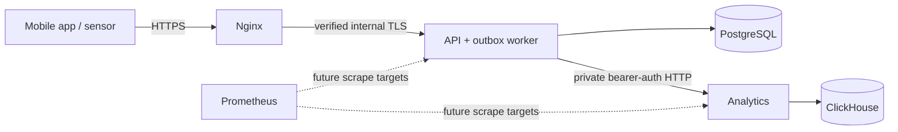

# Machine Whisperer Single-Server Runtime

**Status:** Approved by the user

**Date:** 2026-11-24

## Intent

Provide a repeatable Docker Compose deployment for one Linux server so the
mobile client and sensor devices can reach the API through Nginx. Keep
PostgreSQL, ClickHouse, and the Analytics service private to the Docker
networks, persist database and Prometheus data, and make migrations part of the
startup flow.

The API owns the outbox exporter; there is no second exporter service. The
mobile app is a native client and is not a server container.

## Current state and constraints

- The repository has separate Go modules for `api` and `analytics`, plus the
  mobile app. It has no Dockerfiles, Compose file, reverse proxy, or Prometheus
  configuration.
- PostgreSQL stores API state and the outbox. The API process exports outbox
  batches to Analytics. Analytics writes and queries telemetry in ClickHouse.
- Both databases need persistent storage. API and Analytics migrations are
  separate explicit commands today.
- API authentication requires Ed25519 signing and verification key files.
  API-to-Analytics calls use a shared bearer secret. ClickHouse and PostgreSQL
  also require credentials.
- The project design requires TLS from external clients to Nginx and from
  Nginx to the API. The API currently serves HTTP only, so the server runtime
  needs a TLS listener and an internal API certificate.
- Neither Go service currently exposes `/metrics`. Prometheus will be ready for
  future application metrics; this change will not add product instrumentation.
- The deployment target is one Linux server with Docker Engine and the Compose
  plugin. It is not a high-availability or multi-host deployment.
- The mobile client is already implemented on Expo SDK 57. The user requested
  upgrading it to Expo SDK 58 as part of making the system ready to run. SDK 58
  uses React Native 0.88; use the [official SDK 58 release notes](https://expo.dev/changelog/sdk-58)
  and [upgrade guide](https://docs.expo.dev/workflow/upgrading-expo-sdk-walkthrough/)
  and preserve the existing screens and API behavior.

## Approaches

1. **Single-server Docker Compose (selected).** Run Nginx, API, Analytics,
   PostgreSQL, ClickHouse, migration jobs, and Prometheus on one host with
   private service networks and file-mounted secrets. This fits the stated
   server target and is straightforward to operate. The host remains a single
   point of failure.
2. **Managed databases and hosted application services.** This reduces
   database operations but requires a cloud provider, service definitions,
   and network/security configuration that have not been selected.
3. **Local-development Compose.** This would be simpler and could use HTTP and
   development credentials, but would not satisfy the server deployment goal.

The user chose the server deployment target. The public domain and certificate
issuer are not yet specified, so this design assumes public TLS certificate
files are provisioned and renewed by the server operator and mounted read-only
for Nginx. The stack will parameterize the domain and certificate paths rather
than hard-code a hostname.

## Runtime layout

Compose runs these services:

- **nginx** publishes ports 80 and 443. Port 80 serves the ACME challenge path
  and redirects other requests to HTTPS. Port 443 terminates public TLS and
  proxies the API over TLS, verifying the API certificate against a mounted
  internal CA. Analytics, databases, and Prometheus are not public routes.
- **api** listens with TLS on its internal edge network and joins the private
  data network for PostgreSQL and Analytics. Nginx overwrites forwarding
  headers; the API trusts only the Nginx edge-network CIDR.
- **api-migrate** runs Goose migrations and exits successfully before API
  startup. It uses the same database URL secret as the API.
- **postgres** is reachable only on the private data network and stores data in
  a named volume.
- **analytics** serves internal ingestion and history routes and stores no
  durable state itself.
- **analytics-migrate** applies the embedded ClickHouse migration and exits
  successfully before Analytics starts.
- **clickhouse** is reachable only on the private data network and stores data
  in a named volume.
- **prometheus** has a named data volume and is reachable from the host only on
  `127.0.0.1:9090`, suitable for access over an SSH tunnel. It initially
  scrapes itself; example API and Analytics jobs remain commented until those
  services expose metrics.

## TLS and secrets

- Nginx uses operator-provided public certificate and key files. The operator
  supplies `DOMAIN` and the certificate paths. Automatic ACME issuance and
  renewal are outside this change until the server domain and certificate
  workflow are known.
- A deployment helper generates a private internal CA and an API server
  certificate with the Compose service name as its SAN. The API key is mounted
  only in the API container; Nginx receives only the CA certificate needed to
  verify the upstream.
- Passwords, database URL, API-to-Analytics token, and signing keys are mounted
  as Compose file secrets from a host directory excluded from source control.
  Application configuration will support secret-file paths where it currently
  accepts only environment values. The official ClickHouse entrypoint receives
  its bootstrap password from a small secret-reading wrapper because its
  documented setup uses environment variables. Reject any secret bytes that a
  Go config reader or shell wrapper cannot preserve instead of silently
  changing credentials across process boundaries.
- Provide a secrets template and generator, but never put generated credentials
  or private keys in Git. Document file permissions and backup handling.
- Restrict database and Prometheus host access. Use a static private edge
  subnet so the API can trust the proxy alone. Keep the Analytics token and
  claim/provisioning request bodies out of proxy logs.

## Migrations, persistence, and operation

- `docker compose up -d --build` builds the API and Analytics images, starts
  PostgreSQL and ClickHouse, runs the two migration jobs, then starts API,
  Analytics, Nginx, and Prometheus after their prerequisites are healthy.
- Use separate multi-stage Dockerfiles for the two Go modules and a minimal
  non-root runtime image. Keep the Go toolchain aligned with each module's
  `go.mod`.
- Persist PostgreSQL, ClickHouse, and Prometheus state in named volumes. Do not
  publish database ports by default. Document backup and restore commands for
  the named volumes; do not claim these local volumes provide off-host backup.
- Provide `.env.server.example` with non-secret settings only, a secrets setup
  script, `.dockerignore` files, and a runbook with prerequisites, startup,
  status/log, upgrade, backup, restore, and shutdown commands.
- Add health endpoints or equivalent container checks where required for
  startup ordering. Do not expose health or metrics routes publicly through
  Nginx.

## Goals

- Start all server-side components and apply migrations using Docker Compose.
- Serve authenticated API traffic through public HTTPS and verified internal
  TLS to the API.
- Keep stateful services private and persistent, and credentials out of
  tracked configuration.
- Include a Prometheus service and secure local access, without inventing
  application metrics before instrumentation is designed.
- Validate Compose configuration and build both service images in CI; run a
  Compose smoke check where the CI Docker environment supports it.

## Non-goals

- Deploying to or logging into a specific server; no hostname, SSH access,
  certificate files, or server credentials have been provided.
- Multi-host scaling, high availability, managed databases, Kubernetes, or
  automated secret rotation.
- Adding application metrics, dashboards, alert rules, node exporters, or
  telemetry simulation. Those can follow once deployment and data seeding are
  in place.
- Building or hosting a web version of the mobile app.

## Open implementation details

- Use the existing module versions and API contracts; choose pinned compatible
  official container tags during implementation.
- Keep the Compose configuration safe by default: no public database ports,
  no public Prometheus port, non-root app containers, health-gated startup, and
  persistent named volumes.
- The operator must provide a routable DNS name and public certificate before
  remote HTTPS access works.
