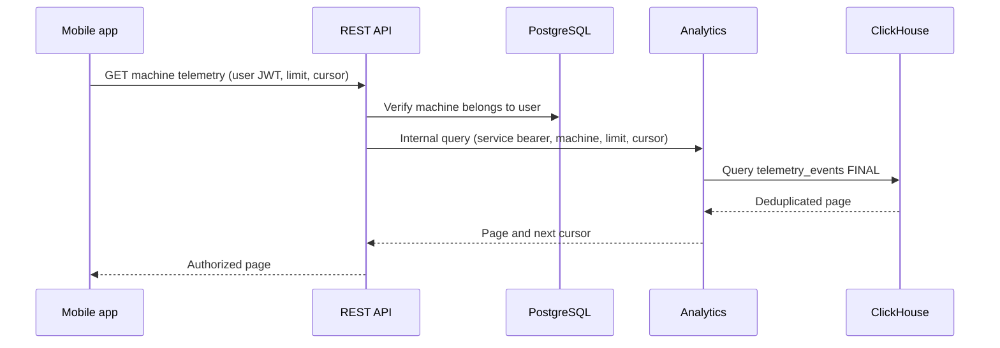

# Telemetry History API

**Status:** Approved for implementation per user's instruction to proceed with the next task

## Intent

Expose bounded telemetry history to an authorized machine owner so the mobile
app can render trends. Keep ClickHouse access inside the Analytics service and
keep user authorization inside the API.

## Goals

- Implement the existing public contract `GET /v1/machines/{machine_id}/telemetry`.
- Return v1 observation values stored in ClickHouse, with stable cursor
  pagination and a bounded page size.
- Authenticate the user and verify machine ownership in the API before it calls
  Analytics.
- Have Analytics verify the internal service credential and query ClickHouse
  with `FINAL` for retry-deduplicated results.
- Return sanitized errors; if Analytics is unavailable, the public API returns a
  retryable service error without exposing internal details.

## Non-goals

- Mobile UI or chart rendering.
- Baseline calibration/detection or alert changes.
- Aggregates/downsampling, exports, arbitrary SQL or direct mobile access to
  Analytics.
- Direct API access to ClickHouse or shared PostgreSQL tables.

## Approaches

1. **API proxy to an authenticated Analytics query route (selected).** The
   API checks the JWT and machine owner, then sends a bounded internal query to
   Analytics. Analytics owns the ClickHouse query and applies `FINAL`. This
   preserves the existing service boundary and lets the public API keep its
   user authorization contract.
2. **Let the API query ClickHouse directly.** Rejected because the API would
   gain ClickHouse credentials and duplicate Analytics storage knowledge.
3. **Expose Analytics directly to the app.** Rejected because it bypasses the
   API's machine ownership checks and makes an internal service public.

## Proposed contract

The public endpoint returns newest observations first:

```http
GET /v1/machines/{machine_id}/telemetry?limit=100&cursor=<opaque>
```

`limit` defaults to 100 and is bounded to 1,000. The optional opaque cursor
identifies the last row using the full ClickHouse order key
`(observed_at, device_id, event_id)`, so equal observation timestamps paginate
deterministically across multiple devices. Responses contain an `items` array
and `next_cursor`, which is null when the page is exhausted. The query fetches
`limit + 1` rows to determine whether another page exists. Each item contains
the event envelope (`device_id`, `event_id`, `received_at`) and the complete v1
observation (`schema_version`, `observed_at`, `operating_state`,
`vibration_rms_g`, `dominant_frequency_hz`, `current_rms_a`). UUIDs are
canonical strings; timestamps are UTC RFC3339 with up to microsecond precision;
optional frequency/current fields are explicit JSON `null` when absent. Limits
outside `1..1000`, malformed cursors and cursors for another machine return
`400` instead of being clamped.

The user confirmed the API-to-Analytics proxy boundary. The API uses the existing owner-scoped machine repository before calling the
internal Analytics route. Analytics uses the existing internal bearer token,
validates UUIDs, limits and cursors, binds query values, and reads
`telemetry_events FINAL`. It orders by the cursor key and applies the same page
limit. The cursor carries `observed_at`, `device_id`, and `event_id` in a
base64url JSON token; the timestamp round-trips at DateTime64(6) precision, and
device/event cursor values are parsed to UUIDs before ClickHouse comparison. The
descending next-page filter is strict on the complete tuple, preventing repeats
or skips at timestamp ties. There is no time-range filter in the initial
endpoint; bounded pages allow clients to walk older history without unbounded
queries.

Malformed machine IDs, limits or cursors return `400`; inaccessible machines
return `404`. An internal Analytics `400` maps to the public invalid-query
response. Internal authentication failures, transport errors, timeouts and
ClickHouse failures map to a sanitized retryable `503`; Analytics never returns
ClickHouse error text to the API caller.



## Decisions for implementation

- Use the documented tuple order for the cursor, not observation timestamp
  alone; event IDs are device-scoped and multiple devices can report at the
  same time.
- Keep the cursor opaque to clients but validate/decode it before parameterized
  ClickHouse queries.
- Leave the body and response within the established telemetry v1 schema; do
  not expose ClickHouse types or query details.
- Verify exact cursor encoding, error statuses and service-key configuration in
  the implementation plan before coding.
